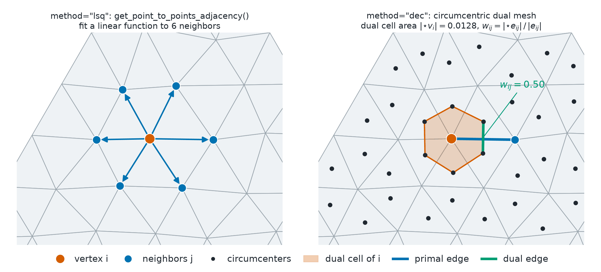

Discrete Calculus
=================

.. currentmodule:: physicsnemo.mesh.calculus

``physicsnemo.mesh.calculus`` computes derivatives of fields on a mesh and
integrates fields over it. Each operator takes a mesh and a tensor of point or
cell values, and returns a tensor.

:bdg-success:`GPU` :bdg-info:`autograd` :bdg-secondary:`any dimension` :bdg-warning:`curl in 3D only`

.. grid:: 2 2 4 4
   :gutter: 2

   .. grid-item-card:: Gradient
      :shadow: md

      :math:`\nabla\varphi`

      scalar to vector

   .. grid-item-card:: Divergence
      :shadow: md

      :math:`\nabla\cdot\mathbf{v}`

      vector to scalar

   .. grid-item-card:: Curl
      :shadow: md

      :math:`\nabla\times\mathbf{v}`

      vector to vector, in 3D

   .. grid-item-card:: Laplacian
      :shadow: md

      :math:`\Delta\varphi = \nabla\cdot\nabla\varphi`

      scalar to scalar

.. figure:: ../../img/mesh/calculus_lsq_vs_dec.png
   :alt: Two square maps of the gradient error, one for least squares (LSQ)
         and one for discrete exterior calculus (DEC),
         dark inside with a bright rim on the boundary. Beside them, a log-log
         plot of the error against the mesh spacing: four parallel lines (LSQ
         and DEC, at interior and boundary vertices) next to a slope-1
         reference line. The boundary lines lie five to eight times higher
         than the interior lines.
   :align: center
   :width: 100%

   Error of the LSQ and DEC vertex gradients of a smooth field on a jittered
   grid. Both methods converge at first order on this grid, and the error at
   boundary vertices stays five to eight times larger.

.. rubric:: Most Used

.. grid:: 1 1 3 3
   :gutter: 2

   .. grid-item-card:: Derivatives of Named Fields
      :link: physicsnemo.mesh.calculus.compute_point_derivatives
      :link-type: any
      :shadow: md
      :class-card: sd-card-hover

      ``mesh.compute_point_derivatives(keys="T")`` stores the gradient as
      ``"T_gradient"``.

   .. grid-item-card:: Laplacian
      :link: physicsnemo.mesh.calculus.compute_laplacian_points_dec
      :link-type: any
      :shadow: md
      :class-card: sd-card-hover

      ``compute_laplacian_points_dec(mesh, u)`` gives the Laplace-Beltrami
      operator at points.

   .. grid-item-card:: Integration
      :link: physicsnemo.mesh.calculus.integrate
      :link-type: any
      :shadow: md
      :class-card: sd-card-hover

      ``mesh.integrate(field)`` integrates cell or point values over the
      mesh.

Example
-------

The following example computes derivatives of fields on a tetrahedral cube.
Pick a method in the tabs. The rest of the example is the same for both:

.. tab-set::
   :sync-group: method

   .. tab-item:: LSQ
      :sync: lsq

      .. code:: python

          from physicsnemo.mesh.primitives.volumes import cube_volume

          mesh = cube_volume.load(subdivisions=4)  # tetrahedra in 3D

          # The gradient of T = x + 2y is (1, 2, 0). The Mesh method stores it as "T_gradient".
          mesh.point_data["T"] = mesh.points[:, 0] + 2 * mesh.points[:, 1]
          mesh = mesh.compute_point_derivatives(keys="T", method="lsq")
          print(mesh.point_data["T_gradient"][0])  # about (1, 2, 0)

   .. tab-item:: DEC
      :sync: dec

      .. code:: python

          from physicsnemo.mesh.primitives.volumes import cube_volume

          mesh = cube_volume.load(subdivisions=4)  # tetrahedra in 3D

          # The gradient of T = x + 2y is (1, 2, 0). The Mesh method stores it as "T_gradient".
          mesh.point_data["T"] = mesh.points[:, 0] + 2 * mesh.points[:, 1]
          mesh = mesh.compute_point_derivatives(keys="T", method="dec")
          print(mesh.point_data["T_gradient"][0])  # about (1, 2, 0)

.. code:: python

    from physicsnemo.mesh.calculus import (
        compute_curl_points_lsq,
        compute_divergence_points_lsq,
        compute_laplacian_points_dec,
    )

    # v = (x, y, z) has divergence 3 and curl 0.
    velocity = mesh.points.clone()
    div_v = compute_divergence_points_lsq(mesh, velocity)  # (n_points,), about 3
    curl_v = compute_curl_points_lsq(mesh, velocity)  # (n_points, 3), about 0

    # The DEC Laplacian of u = x^2 + y^2 + z^2 is 6 at interior points.
    u = (mesh.points**2).sum(dim=-1)
    lap_u = compute_laplacian_points_dec(mesh, u)  # (n_points,)

On a curved surface or curve, an intrinsic gradient lies in the tangent space
of the mesh, and an extrinsic gradient lies in the ambient space. Select one
with ``gradient_type="intrinsic"`` (the default), ``"extrinsic"``, or
``"both"``.

Choosing a Method
-----------------

Two methods compute the operators:

.. grid:: 1 1 2 2
   :gutter: 3

   .. grid-item-card:: LSQ, the Default
      :shadow: md

      Weighted least squares fits a linear function to each point's
      neighborhood, as in finite-volume computational fluid dynamics (CFD).
      It supports the following:

      - Gradient, divergence, and curl
      - At points and at cells
      - ``method="lsq"``

      **Watch out:** LSQ has no Laplacian.

   .. grid-item-card:: DEC
      :shadow: md

      Discrete exterior calculus uses the circumcentric dual mesh and the
      Hodge star, after Desbrun, Hirani, Leok, and Marsden
      (`arXiv:math/0508341 <https://arxiv.org/abs/math/0508341>`_). It
      supports the following:

      - Gradient, divergence, and Laplacian
      - At points only
      - ``method="dec"``

      **Watch out:** DEC has no curl and no cell derivatives.

         vertex with arrows to its blue neighbor vertices. Right: dots at the
         circumcenters of the triangles around the vertex, which bound its
         shaded dual cell. One primal edge is crossed by its dual edge.
   :align: center
   :width: 100%

   How the two methods see one vertex. LSQ fits a linear function to the
   values at the neighbors. DEC works on the circumcentric dual cell of the
   vertex and on the dual edge of each primal edge.

.. warning::

   ``compute_cell_derivatives(..., method="dec")`` raises
   ``NotImplementedError``. Use ``method="lsq"`` for derivatives of
   ``cell_data``.

Use the following guidelines to choose a function:

- Use :meth:`~physicsnemo.mesh.mesh.Mesh.compute_point_derivatives` or
  :meth:`~physicsnemo.mesh.mesh.Mesh.compute_cell_derivatives` to add
  gradients of named fields to the mesh data.
- Use the ``compute_*`` functions for a tensor result without changing the
  mesh.
- For the Laplacian, use :func:`compute_laplacian_points_dec`.
- Expect larger errors at boundary points, where the neighborhood is
  one-sided, as the error figure shows. The User Guide compares the two
  methods in detail.

Effective Measures and Integration
----------------------------------

The reserved ``_effective_measure`` field stores one complete integration
measure for each cell or point in ``cell_data`` or ``point_data``. Read these
with ``cell_measures(mesh)`` or ``point_measures(mesh)``. They already include
any geometric contribution and sampling correction. Two integrals use them:

* ``mesh.integrate(field, data_source="cells")`` integrates piecewise-constant
  cell values. ``data_source="points"`` integrates piecewise-linear vertex
  values over the same cells. Both use cell measures, which default to the
  geometric simplex measures.
* ``mesh.integrate_samples(field)`` sums independent point samples times their
  point measures, regardless of connectivity. Explicit point measures are
  required. For counting measure, use an ordinary sum.

Use ``set_cell_measures`` or ``set_point_measures`` to assign measures. Point
measures require their represented ``dimension``:

.. list-table::
   :header-rows: 1
   :widths: 30 70

   * - ``dimension``
     - Measure
   * - 0
     - Counting
   * - 1
     - Length
   * - 2
     - Area
   * - 3
     - Volume

``scale_measures`` multiplies existing measures by a scalar or a factor for
each cell or point, such as an inverse sampling probability. Raw slicing does
not apply a sampling correction.

Converting cells to centroid samples transfers their measures automatically:

.. code:: python

    from physicsnemo.mesh.primitives.planar import unit_square

    square = unit_square.load(subdivisions=3)
    queries = square.to_point_cloud(point_source="cell_centroids")
    values = queries.points[:, 0]  # Integrate f(x, y) = x over the unit square.
    print(queries.integrate_samples(values))  # tensor(0.5000)

For vertex quadrature, ``lumped_point_measures(mesh)`` distributes each cell's
measure equally among its vertices without modifying the mesh. For finite
fields, these weights reproduce piecewise-linear integration.

Refer to :doc:`transformations` for the geometric changes that keep reference
measures.

Summary
-------

.. rubric:: Derivatives

.. autosummary::
   :nosignatures:

   compute_point_derivatives
   compute_cell_derivatives
   compute_gradient_points_lsq
   compute_gradient_points_dec
   compute_gradient_cells_lsq
   compute_divergence_points_lsq
   compute_divergence_points_dec
   compute_divergence_cells_lsq
   compute_curl_points_lsq
   compute_curl_cells_lsq
   compute_laplacian_points_dec

.. rubric:: Integration and Measures

.. autosummary::
   :nosignatures:

   integrate
   integrate_cell_data
   integrate_point_data
   integrate_samples
   integrate_flux
   integrate_moment
   cell_measures
   point_measures
   set_cell_measures
   set_point_measures
   scale_measures
   lumped_point_measures

Related Topics
--------------

For more information, refer to the following resources:

- :doc:`curvature` and :doc:`geometry`.
- User Guide: `Using Mesh
  <https://docs.nvidia.com/physicsnemo/latest/user-guide/mesh/using_mesh.html>`_
- Tutorial: `Discrete Calculus and Curvature
  <https://github.com/NVIDIA/physicsnemo/blob/main/examples/minimal/mesh/tutorial_5_calculus.ipynb>`_

API Reference
-------------

Derivatives
^^^^^^^^^^^

.. autofunction:: compute_point_derivatives

.. autofunction:: compute_cell_derivatives

.. autofunction:: compute_gradient_points_lsq

.. autofunction:: compute_gradient_points_dec

.. autofunction:: compute_gradient_cells_lsq

.. autofunction:: compute_divergence_points_lsq

.. autofunction:: compute_divergence_points_dec

.. autofunction:: compute_divergence_cells_lsq

.. autofunction:: compute_curl_points_lsq

.. autofunction:: compute_curl_cells_lsq

.. autofunction:: compute_laplacian_points_dec

Integration and Measures
^^^^^^^^^^^^^^^^^^^^^^^^

.. autofunction:: integrate

.. autofunction:: integrate_cell_data

.. autofunction:: integrate_point_data

.. autofunction:: integrate_samples

.. autofunction:: integrate_flux

.. autofunction:: integrate_moment

.. autofunction:: cell_measures

.. autofunction:: point_measures

.. autofunction:: set_cell_measures

.. autofunction:: set_point_measures

.. autofunction:: scale_measures

.. autofunction:: lumped_point_measures

.. py:data:: EFFECTIVE_MEASURE_KEY
   :value: "_effective_measure"

   The reserved ``cell_data`` and ``point_data`` key that stores measures.

.. py:data:: POINT_MEASURE_DIMENSION_KEY
   :value: "_point_measure_dimension"

   The reserved ``global_data`` key that stores the dimension of point
   measures.
