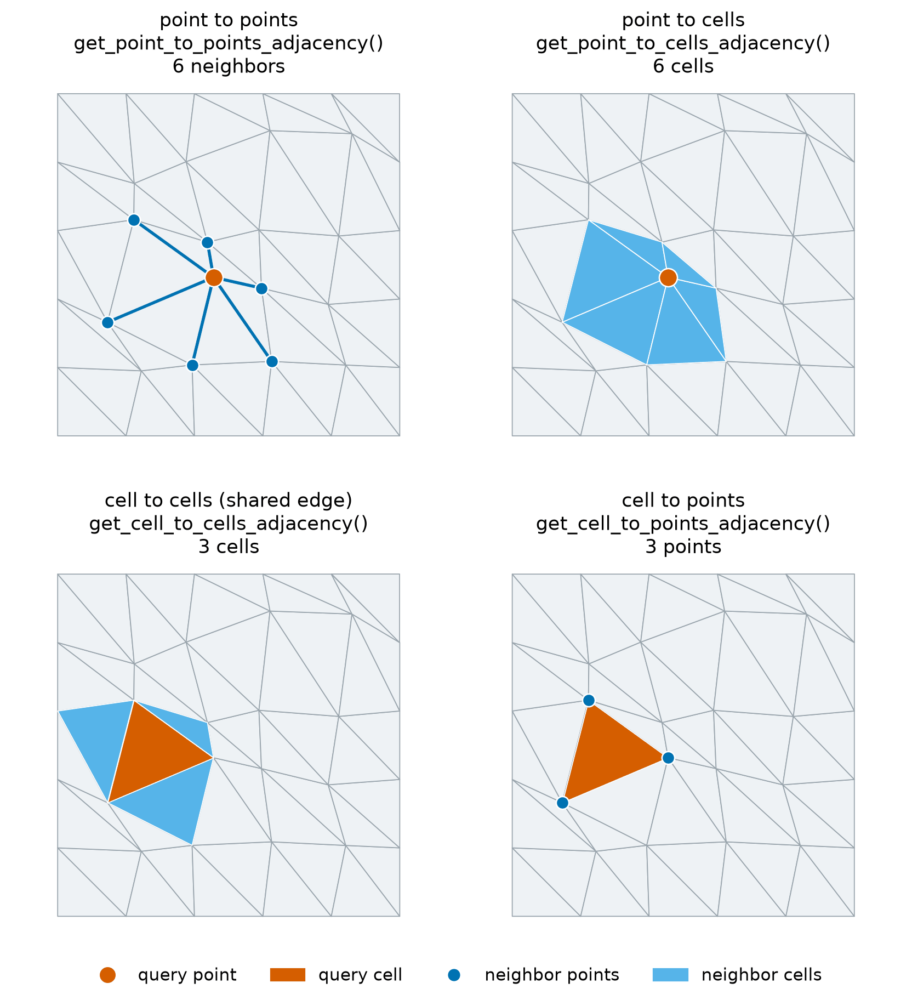

Neighbors and Adjacency
=======================

.. currentmodule:: physicsnemo.mesh.neighbors

``physicsnemo.mesh.neighbors`` computes which points and cells of a mesh are
connected to which others. These queries use the connectivity in
``mesh.cells``, not distances. For queries by distance, refer to
:doc:`spatial`.

There are four adjacency queries:

- Point to points: the points that share an edge with each point (the mesh
  graph).
- Point to cells: the cells that contain each point (the star of the point).
- Cell to cells: the cells that share a facet with each cell. Set
  ``adjacency_codimension=2`` to also count cells that share only an edge of
  a tetrahedral mesh, or only a vertex of a triangle mesh.
- Cell to points: the points of each cell.

Each query returns an :class:`Adjacency`, a ragged array in compressed sparse
row (CSR) form. The neighbors of source ``i`` are
``indices[offsets[i]:offsets[i + 1]]``. ``offsets`` has ``n_sources + 1``
entries. Use :meth:`Adjacency.to_list` for a Python list of lists, and
:meth:`Adjacency.expand_to_pairs` for ``(source, target)`` pairs, the form of
a PyTorch Geometric ``edge_index``.

         six neighbor points. Top right: the same point with its six
         surrounding cells filled. Bottom left: a triangle and the three
         triangles that share an edge with it. Bottom right: the same triangle
         with its three vertices marked.
   :align: center
   :width: 100%

   The four adjacency queries on one jittered triangle mesh. Each panel
   highlights a query point or cell in orange and the neighbors returned for
   it in blue.

Example
-------

The following example runs the four queries on a small square mesh:

.. code:: python

    from physicsnemo.mesh.primitives.planar import unit_square

    mesh = unit_square.load(subdivisions=1)  # 9 points, 8 triangles
    print(mesh.cells[0].tolist())  # [0, 1, 3]

    p2p = mesh.get_point_to_points_adjacency()
    print(p2p.offsets.tolist())  # [0, 2, 6, 9, 13, 19, 23, 26, 30, 32]
    print(p2p.to_list()[4])  # [1, 2, 3, 5, 6, 7]: the center point

    print(mesh.get_point_to_cells_adjacency().to_list()[4])  # [1, 2, 3, 4, 5, 6]
    print(mesh.get_cell_to_cells_adjacency().to_list()[0])  # [1]
    print(mesh.get_cell_to_points_adjacency().to_list()[0])  # [0, 1, 3]

    # Ragged arrays as (source, target) pairs, for example to build a graph.
    sources, targets = p2p.expand_to_pairs()
    print(sources.shape, p2p.n_total_neighbors)  # torch.Size([32]) 32

``offsets`` are always ``int64``. ``indices`` of the point-to-points and
cell-to-points queries have the dtype of ``mesh.cells``, so an ``int32`` mesh
gives ``int32`` indices. The other two queries give ``int64`` indices.

The same queries are functions in this module, such as
:func:`get_point_to_points_adjacency`. The ``Mesh`` methods cache their
result, and the cache stays valid through geometric transformations.

Choosing a Function
-------------------

Use the following guidelines to choose a function:

- For a graph of the mesh, use point to points. For a graph of the cells,
  such as the input of a graph neural network on cells, use cell to cells.
  ``mesh.to_edge_graph()`` and ``mesh.to_dual_graph()`` return the same
  graphs as ``Mesh`` objects of edges.
- Use point to cells to gather cell values at a point, and cell to points to
  gather point values at a cell.
- Use :func:`build_adjacency_from_pairs` to build an :class:`Adjacency` from
  your own ``(source, target)`` pairs.

Summary
-------

.. autosummary::
   :nosignatures:

   Adjacency
   get_point_to_points_adjacency
   get_point_to_cells_adjacency
   get_cell_to_cells_adjacency
   get_cell_to_points_adjacency
   build_adjacency_from_pairs

Related Topics
--------------

Refer to the following pages for related topics:

- :doc:`boundaries` for facets and boundaries.
- Tutorial: `Neighbors, Adjacency, and Spatial Queries
  <https://github.com/NVIDIA/physicsnemo/blob/main/examples/minimal/mesh/tutorial_6_neighbors_spatial.ipynb>`_

API Reference
-------------

.. autoclass:: Adjacency
   :members:
   :show-inheritance:

.. autofunction:: get_point_to_points_adjacency

.. autofunction:: get_point_to_cells_adjacency

.. autofunction:: get_cell_to_cells_adjacency

.. autofunction:: get_cell_to_points_adjacency

.. autofunction:: build_adjacency_from_pairs
