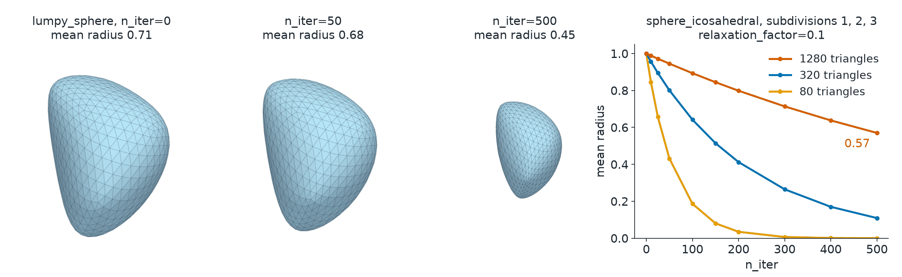

Smoothing
=========

.. currentmodule:: physicsnemo.mesh.smoothing

``physicsnemo.mesh.smoothing`` makes a mesh more regular by moving its
points. Its one function, :func:`smooth_laplacian`, returns a mesh with new
point positions and the same connectivity.

:bdg-success:`GPU` :bdg-info:`autograd` :bdg-secondary:`any dimension` :bdg-warning:`shrinks closed surfaces`

         growing smoother and smaller. Right: a line plot of the mean radius
         against the number of iterations for three icosahedral spheres of
         increasing resolution, with the coarsest one falling fastest.
   :align: center
   :width: 100%

   Left: :func:`smooth_laplacian` on a lumpy sphere at 0, 50, and 500
   iterations with ``relaxation_factor=0.1``. Right: the mean radius of
   icosahedral unit spheres against the number of iterations. Coarser meshes
   shrink faster.

.. rubric:: Most Used

.. grid:: 1 1 2 2
   :gutter: 2

   .. grid-item-card:: Laplacian Smoothing
      :link: physicsnemo.mesh.smoothing.smooth_laplacian
      :link-type: any
      :shadow: md
      :class-card: sd-card-hover

      ``smooth_laplacian(mesh, n_iter=50)`` moves each point toward its
      neighbors.

   .. grid-item-card:: Repair
      :link: repair
      :link-type: doc
      :shadow: md
      :class-card: sd-card-hover

      Remove duplicate points and degenerate cells before you smooth.

   .. grid-item-card:: Remeshing
      :link: remeshing
      :link-type: doc
      :shadow: md
      :class-card: sd-card-hover

      Rebuild a triangle surface with a target number of vertices.

   .. grid-item-card:: Subdivision
      :link: subdivision
      :link-type: doc
      :shadow: md
      :class-card: sd-card-hover

      Refine every cell, and smooth the surface with Loop or Butterfly.

Example
-------

.. code:: python

    from physicsnemo.mesh.primitives.procedural import lumpy_sphere
    from physicsnemo.mesh.smoothing import smooth_laplacian

    mesh = lumpy_sphere.load(subdivisions=3, seed=0)
    smoothed = smooth_laplacian(mesh, n_iter=50, relaxation_factor=0.1)
    print(smoothed.n_points == mesh.n_points)  # True

Each iteration of
`Laplacian smoothing <https://en.wikipedia.org/wiki/Laplacian_smoothing>`_
moves each point toward a weighted average of its neighbors. Meshes of
codimension 1 with a manifold dimension of 2 or more use cotangent weights.
Other meshes use uniform weights.

.. warning::

   Many iterations shrink a closed surface. For example, 500 iterations with
   ``relaxation_factor=0.1`` reduce the mean radius of
   ``sphere_icosahedral.load(subdivisions=3)``, a unit sphere, to about 0.57.

Choosing Parameters
-------------------

The following parameters control how far the points move:

.. list-table::
   :header-rows: 1
   :widths: 30 15 55

   * - Parameter
     - Default
     - Effect
   * - ``n_iter``
     - 20
     - The number of iterations.
   * - ``relaxation_factor``
     - 0.01
     - How far each point moves toward the average in one iteration, in
       (0, 1].
   * - ``convergence``
     - 0.0
     - Stop early when no point moves more than this fraction of the bounding
       box diagonal. 0.0 turns early stopping off.
   * - ``preserve_boundaries``
     - ``True``
     - Hold boundary points in place.
   * - ``preserve_features``
     - ``False``
     - On a mesh of codimension 1, hold the points of edges with a dihedral
       angle above ``feature_angle`` degrees (default 45).

To change the connectivity, use :doc:`remeshing` or :doc:`subdivision`.

Summary
-------

.. autosummary::
   :nosignatures:

   smooth_laplacian

Related Topics
--------------

For more information, refer to the following resources:

- Tutorial: `Quality, Validation, and Repair
  <https://github.com/NVIDIA/physicsnemo/blob/main/examples/minimal/mesh/tutorial_7_quality_repair.ipynb>`_

API Reference
-------------

.. autofunction:: smooth_laplacian
