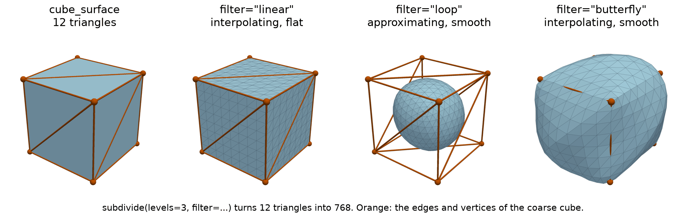

Subdivision
===========

.. currentmodule:: physicsnemo.mesh.subdivision

``physicsnemo.mesh.subdivision`` refines a mesh by splitting each n-simplex
into :math:`2^n` child simplices: each edge becomes two edges, each triangle
four triangles, and each tetrahedron eight tetrahedra. New points go at or
near the edge midpoints. There are three schemes:

Linear (midpoint)
    New points go at the exact edge midpoints. This scheme is interpolating:
    the original points keep their positions. It is the fastest scheme and
    the only one for every manifold dimension. It does not smooth, so each
    original cell stays visible as a flat facet of the refined mesh.

Loop (`Loop, 1987 <https://www.microsoft.com/en-us/research/publication/smooth-subdivision-surfaces-based-on-triangles/>`_)
    A weighted average that depends on the valence (number of neighbors) of
    each point gives smooth limit surfaces. This scheme is approximating: it
    also moves the original points, so on a convex surface the refined mesh
    lies inside the coarse one. It is the standard choice for a smooth surface
    from a coarse triangle mesh.

Butterfly (`Zorin et al., 1996 <https://cims.nyu.edu/gcl/papers/zorin1996ism.pdf>`_)
    A weighted stencil gives smooth surfaces and keeps the original points
    fixed (interpolating). Use it when the refined mesh must pass through the
    original points. Because it cannot move the original points, it is less
    robust than Loop on irregular meshes.

Loop and Butterfly need a triangle mesh (``n_manifold_dims == 2``). All
schemes carry ``point_data`` and ``cell_data`` to the refined mesh.

         and Butterfly subdivisions. The linear result keeps flat facets, and
         the Loop and Butterfly results are smooth.
   :align: center
   :width: 100%

   A coarse closed surface and its linear, Loop, and Butterfly subdivisions.

Example
-------

.. code:: python

    from physicsnemo.mesh.primitives.surfaces import sphere_icosahedral
    from physicsnemo.mesh.subdivision import subdivide_butterfly, subdivide_linear, subdivide_loop

    mesh = sphere_icosahedral.load(subdivisions=0)  # an icosahedron: 12 points, 20 triangles

    # One level of each scheme: 42 points, 80 triangles
    linear = subdivide_linear(mesh)
    smooth = subdivide_loop(mesh)
    interpolated = subdivide_butterfly(mesh)
    print(linear.n_points, linear.n_cells)  # 42 80

    # The Mesh method applies several levels.
    refined = mesh.subdivide(levels=2, filter="loop")
    print(refined.n_cells)  # 320

Summary
-------

.. autosummary::
   :nosignatures:

   subdivide_linear
   subdivide_loop
   subdivide_butterfly

See Also
--------

- :doc:`remeshing` for a new mesh with a target number of points.
- Tutorial: `Mesh Operations
  <https://github.com/NVIDIA/physicsnemo/blob/main/examples/minimal/mesh/tutorial_4_operations.ipynb>`_

API Reference
-------------

.. autofunction:: subdivide_linear

.. autofunction:: subdivide_loop

.. autofunction:: subdivide_butterfly
