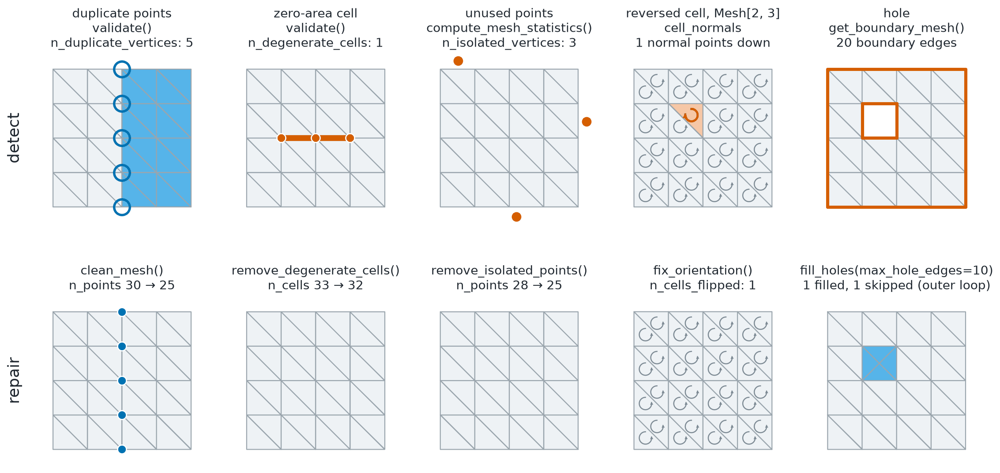

Validation and Quality
======================

.. currentmodule:: physicsnemo.mesh.validation

``physicsnemo.mesh.validation`` checks the integrity of a mesh and measures
the quality of its cells. It returns a report of the problems it finds, one
quality value for each cell, and summary statistics.

:bdg-success:`GPU` :bdg-secondary:`any dimension`

         points, a degenerate cell, a reversed cell, and a hole. The top row
         shows each defect highlighted in orange, the middle row what the
         validation check reports, and the bottom row the mesh after the
         repair.
   :align: center
   :width: 100%

   Common mesh defects, the check that finds each one, and the function in
   :doc:`repair` that fixes it.

.. rubric:: Most Used

.. grid:: 1 1 3 3
   :gutter: 2

   .. grid-item-card:: Validate
      :link: physicsnemo.mesh.validation.validate
      :link-type: any
      :shadow: md
      :class-card: sd-card-hover

      ``mesh.validate()`` returns a ``dict`` with ``"valid"`` and a count for
      each problem.

   .. grid-item-card:: Quality Metrics
      :link: physicsnemo.mesh.validation.compute_quality_metrics
      :link-type: any
      :shadow: md
      :class-card: sd-card-hover

      ``mesh.quality_metrics`` gives a ``TensorDict`` with one value for each
      cell.

   .. grid-item-card:: Statistics
      :link: physicsnemo.mesh.validation.compute_mesh_statistics
      :link-type: any
      :shadow: md
      :class-card: sd-card-hover

      ``mesh.statistics`` gives counts and summaries of cell sizes and
      quality.

Example
-------

.. code:: python

    from physicsnemo.mesh.primitives.surfaces import sphere_icosahedral

    mesh = sphere_icosahedral.load(subdivisions=2)

    report = mesh.validate(check_manifoldness=True)
    print(report)

.. code-block:: text
   :caption: Output

   {'valid': True, 'n_out_of_bounds_cells': 0, 'n_duplicate_vertices': 0, 'n_degenerate_cells': 0,
    'is_manifold': True, 'n_non_manifold_edges': 0}

.. code:: python

    quality = mesh.quality_metrics  # TensorDict, batch size (n_cells,)
    print(list(quality.keys()))

.. code-block:: text
   :caption: Output

   ['aspect_ratio', 'edge_length_ratio', 'min_angle', 'max_angle',
    'min_edge_length', 'max_edge_length', 'quality_score']

.. code:: python

    stats = mesh.statistics
    print(stats["n_cells"], stats["n_degenerate_cells"])  # 320 0

The statistics summarize cell areas, edge lengths, aspect ratios, and quality
scores, each as a tuple of minimum, mean, maximum, and standard deviation.

Choosing a Check
----------------

:func:`validate` runs the following checks. Options that are off by default
cost more time:

.. list-table::
   :header-rows: 1
   :widths: 34 12 54

   * - Option
     - Default
     - Finds
   * - ``check_out_of_bounds``
     - on
     - Cells whose point indices are out of range
   * - ``check_duplicate_vertices``
     - on
     - Points that coincide within ``tolerance``
   * - ``check_degenerate_cells``
     - on
     - Cells with zero or negative area or volume
   * - ``check_inverted_cells``
     - off
     - Cells with a negative signed volume, on meshes of codimension 0 such
       as triangles in 2D or tetrahedra in 3D. Other meshes report ``-1``.
   * - ``check_manifoldness``
     - off
     - Edges that break manifold topology, on meshes with a manifold
       dimension of 2

With ``raise_on_error=True``, :func:`validate` raises ``ValueError`` at the
first problem instead of returning a report. For watertight and manifold
checks of any mesh, refer to :doc:`boundaries`.

.. note::

   ``validate_mesh`` is a compatibility name for :func:`validate`. It is
   pending deprecation.

Summary
-------

.. autosummary::
   :nosignatures:

   validate
   compute_quality_metrics
   compute_mesh_statistics
   validate_mesh

Related Topics
--------------

For more information, refer to the following resources:

- :doc:`repair` to fix the problems that validation finds.
- :doc:`boundaries` for watertight and manifold checks.
- Tutorial: `Quality, Validation, and Repair
  <https://github.com/NVIDIA/physicsnemo/blob/main/examples/minimal/mesh/tutorial_7_quality_repair.ipynb>`_

API Reference
-------------

.. autofunction:: validate

.. autofunction:: compute_quality_metrics

.. autofunction:: compute_mesh_statistics

.. autofunction:: validate_mesh
