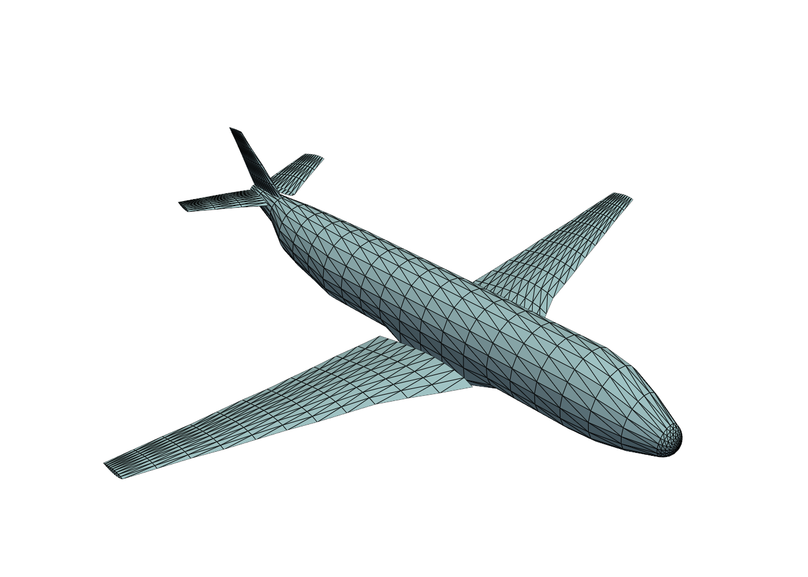
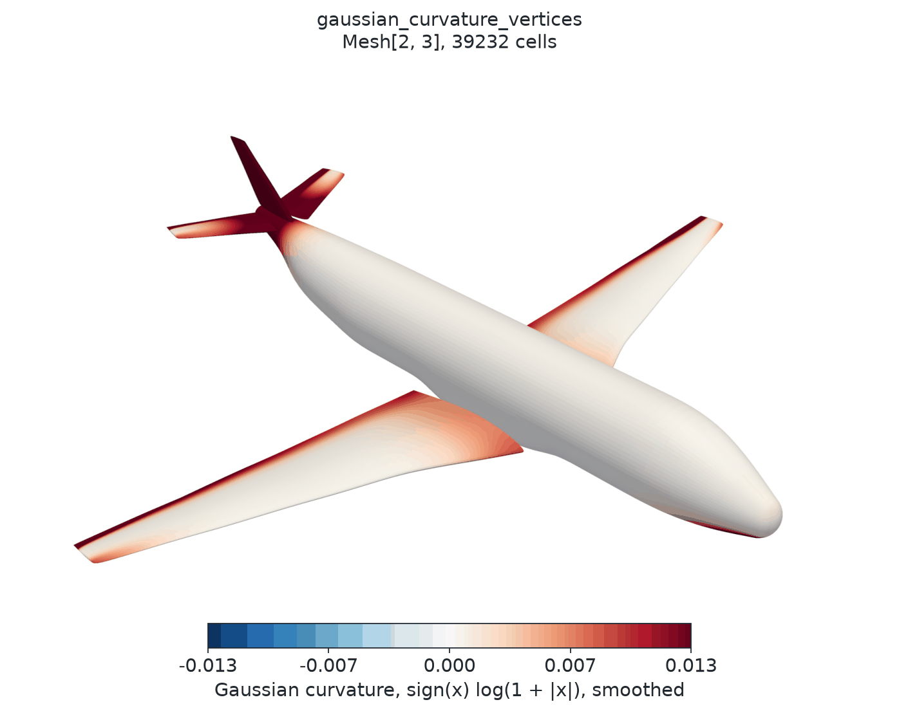
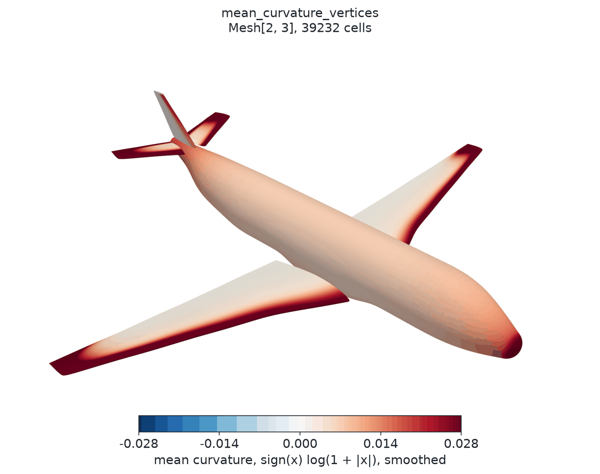

# PhysicsNeMo-Mesh

GPU-accelerated mesh processing for physical simulation and scientific
visualization, in any dimension.

## Documentation

- [User Guide](https://docs.nvidia.com/physicsnemo/latest/user-guide/mesh.html):
  concepts, and how to choose between methods.
- [API reference](https://docs.nvidia.com/physicsnemo/latest/physicsnemo/api/mesh/index.html):
  one page per submodule, with examples.
- [Tutorials](../../examples/minimal/mesh/): executed notebooks, from a first
  mesh to an ML pipeline (see [Tutorials](#tutorials) below).

---

## What is PhysicsNeMo-Mesh?

The word "mesh" means different things to different communities:

- [CFD](https://en.wikipedia.org/wiki/Computational_fluid_dynamics) and
  [FEM](https://en.wikipedia.org/wiki/Finite_element_method) engineers
  think "volume mesh" (3D tetrahedra filling a 3D domain).
- Graphics programmers think "surface mesh" (2D triangles in 3D space).
- Computer vision researchers think "point cloud" (0D vertices in 3D space).
- Robotics engineers think "curves" (1D edges in 2D or 3D space).

PhysicsNeMo-Mesh handles all of these with one dimension-generic data
structure. Formally, PhysicsNeMo-Mesh operates on
arbitrary-dimensional
[pure simplicial complexes](https://en.wikipedia.org/wiki/Simplicial_complex)
embedded in arbitrary-dimensional
[Euclidean spaces](https://en.wikipedia.org/wiki/Euclidean_space).
Two numbers describe each mesh: the manifold dimension (the dimension of its
cells) and the spatial dimension (the dimension of the space that holds its
points).

This means you can work with:

- 2D triangles in 2D space (planar meshes for 2D simulations)
- 2D triangles in 3D space (surface meshes for graphics and CFD)
- 3D tetrahedra in 3D space (volume meshes for FEM and CFD)
- 1D edges in 3D space (curve meshes for path planning)
- Any other $n$-dimensional manifold in $m$-dimensional space (where $n \leq m$)

all with the same API. The API design takes inspiration from
[PyVista](https://pyvista.org/), with five differences: PhysicsNeMo-Mesh is
GPU-accelerated end to end, dimension-generic, differentiable with autograd
where possible, accepts tensor fields of any rank as data, and supports
nested field data. The core data structure depends on
[PyTorch](https://pytorch.org/) and
[TensorDict](https://github.com/pytorch/tensordict) (an official PyTorch data
structure). Some operations use [Warp](https://github.com/NVIDIA/warp), and
the optional `mesh-extras` (matplotlib, PyVista, VTK) add plotting and file
I/O.

The one restriction: meshes must be simplicial. They consist of
[points](https://en.wikipedia.org/wiki/Point_(geometry)),
[line segments](https://en.wikipedia.org/wiki/Line_segment),
[triangles](https://en.wikipedia.org/wiki/Triangle),
[tetrahedra](https://en.wikipedia.org/wiki/Tetrahedron), and higher-dimensional
[n-simplices](https://en.wikipedia.org/wiki/Simplex). This restriction makes
discrete differential geometry and discrete calculus possible on every mesh,
and it makes the operations fast to vectorize.

---

## Key Features

Core capabilities:

- GPU acceleration: most operations are vectorized with
  [PyTorch](https://pytorch.org/) and run natively on
  [CUDA](https://developer.nvidia.com/cuda-toolkit).
- Dimension-generic: works with n-D manifolds embedded in m-D spaces.
- TensorDict integration: point, cell, and global data are
  [TensorDicts](https://github.com/pytorch/tensordict) that move with the mesh
  between devices.
- Field schemas: `RankSpec` and `FieldSchema` declare how each named field
  transforms under rotations and reflections (its tensor rank, symmetry, and
  parity), so that a model can declare and check its inputs.
- Simulation domains: `DomainMesh` holds an interior mesh with named boundary
  meshes.
- Differentiable: most operations support
  [PyTorch autograd](https://pytorch.org/docs/stable/autograd.html).

Mathematical operations:

- Discrete calculus: [gradient](https://en.wikipedia.org/wiki/Gradient),
  [divergence](https://en.wikipedia.org/wiki/Divergence),
  [curl](https://en.wikipedia.org/wiki/Curl_(mathematics)), the
  [Laplace-Beltrami operator](https://en.wikipedia.org/wiki/Laplace%E2%80%93Beltrami_operator),
  and integration. These are the core ingredients of a manifold PDE solver
  for many PDEs of industrial interest.
  - Both [DEC](https://en.wikipedia.org/wiki/Discrete_exterior_calculus)
    (Discrete Exterior Calculus) and LSQ (weighted least-squares) methods.
  - Intrinsic (tangent space) and extrinsic (ambient space) derivatives.
- Differential geometry:
  [Gaussian curvature](https://en.wikipedia.org/wiki/Gaussian_curvature),
  [mean curvature](https://en.wikipedia.org/wiki/Mean_curvature),
  [normals](https://en.wikipedia.org/wiki/Normal_(geometry)),
  [tangent spaces](https://en.wikipedia.org/wiki/Tangent_space).
- Curvature analysis: [angle defect](https://en.wikipedia.org/wiki/Angular_defect)
  (intrinsic) and
  [cotangent Laplacian](https://en.wikipedia.org/wiki/Discrete_Laplace_operator)
  (extrinsic) methods.

Mesh operations:

- Subdivision: linear,
  [Loop](https://en.wikipedia.org/wiki/Loop_subdivision_surface)
  (approximating), and
  [Butterfly](https://en.wikipedia.org/wiki/Butterfly_subdivision_surface)
  (interpolating) schemes.
- Smoothing: [Laplacian smoothing](https://en.wikipedia.org/wiki/Laplacian_smoothing)
  with optional feature preservation.
- Remeshing: Warp-based uniform and field-controlled remeshing on CPU and
  CUDA, with barycentric point-data transfer.
- Repair: remove duplicates, fix orientation, fill holes, clean topology.
- Deformation: dense point displacement, Sobolev-filtered deformation,
  sparse compact control-point deformation, global radial-basis deformation,
  lattice free-form deformation, and nearest-surface shrinkwrap.
- Deformation energies: differentiable strain, local and total measure,
  inversion, triangle-hinge bending, and enclosed-volume penalties for
  fixed-topology optimization.
- Tessellation: triangulate polygon soups into simplicial meshes (convex
  fan, and [ear clipping](https://en.wikipedia.org/wiki/Polygon_triangulation)
  for non-convex polygons); also `Mesh.from_polygons`. `fill_interior` fills
  a closed boundary with quality triangles.
- Generation: marching cubes, and volume meshes of implicit domains defined
  by signed distance functions.

Analysis tools:

- Topology: boundary detection, and
  [watertight](https://en.wikipedia.org/wiki/Watertight_(3D_modeling)) and
  [manifold](https://en.wikipedia.org/wiki/Manifold) checks.
- Neighbors: point-to-points, point-to-cells, cell-to-cells, and cell-to-points
  adjacency, stored in a compact ragged format.
- Quality metrics: aspect ratio, edge lengths, angles, quality scores.
- Spatial queries:
  [BVH](https://en.wikipedia.org/wiki/Bounding_volume_hierarchy)-accelerated
  point containment, nearest-cell search, and signed distance fields.

---

## Quick Start

### Creating a Simple Mesh

```python
import torch
from physicsnemo.mesh import Mesh

# Create a triangle mesh in 2D
points = torch.tensor([[0.0, 0.0], [1.0, 0.0], [0.5, 1.0]])

# Points 0, 1, and 2 form one cell (in 2D, a triangle)
cells = torch.tensor([[0, 1, 2]])

mesh = Mesh(points=points, cells=cells)
print(mesh)
```

Output (the dimensions come from the shapes of `points` and `cells`):

```text
Mesh[n_manifold_dims=2, n_spatial_dims=2](n_points=3, n_cells=1)
```

### Adding Data to a Mesh

```python
# Scalar data (shape: n_points or n_cells)
mesh.point_data["temperature"] = torch.tensor([300.0, 350.0, 325.0])
mesh.cell_data["pressure"] = torch.tensor([101.3])

# Vector data (shape: n_points × n_spatial_dims or n_cells × n_spatial_dims)
mesh.point_data["velocity"] = torch.tensor([[1.0, 0.5], [0.8, 1.2], [0.0, 0.9]])

# Tensor data (shape: n_cells × n_spatial_dims × n_spatial_dims)
# Reynolds stress tensor: symmetric 2×2 tensor for each cell
mesh.cell_data["reynolds_stress"] = torch.tensor([[[2.1, 0.3], [0.3, 1.8]]])

print(mesh)
```

Output (each data field shows its trailing dimensions):

```text
Mesh[n_manifold_dims=2, n_spatial_dims=2](n_points=3, n_cells=1)
    point_data: {temperature: (), velocity: (2,)}
    cell_data : {pressure: (), reynolds_stress: (2, 2)}
```

### Loading a Real Mesh

```python
from physicsnemo.mesh.io import from_pyvista
import pyvista as pv

# Load any mesh format PyVista supports
pv_mesh = pv.examples.load_airplane()  # See pyvista.org for more datasets
mesh = from_pyvista(pv_mesh)

# Or, equivalently:
from physicsnemo.mesh.primitives.pyvista_datasets.airplane import load

mesh = load()

print(mesh)
```

Output:

```text
Mesh[n_manifold_dims=2, n_spatial_dims=3](n_points=1335, n_cells=2452, device=cpu)
```

This is a 2D surface mesh (triangles) embedded in 3D space: a typical
graphics or CAD mesh.

Then, with `mesh.draw()`, you can visualize the mesh:



### Computing Curvature

Starting with the airplane mesh, compute its
[Gaussian curvature](https://en.wikipedia.org/wiki/Gaussian_curvature) on a
smoother, refined surface:

```python
mesh = mesh.subdivide(levels=2, filter="loop")
mesh.point_data["gaussian_curvature"] = mesh.gaussian_curvature_vertices
mesh.draw(
    point_scalars="gaussian_curvature",
    show_edges=False,
    cmap="coolwarm",
)
```



*Warm colors show positive Gaussian curvature (dome-like regions); cool
colors show negative Gaussian curvature (saddle-like regions).*

Or, compute the [mean curvature](https://en.wikipedia.org/wiki/Mean_curvature):

```python
mesh.point_data["mean_curvature"] = mesh.mean_curvature_vertices
mesh.draw(
    point_scalars="mean_curvature",
    show_edges=False,
    cmap="coolwarm",
)
```



*Warm colors show positive mean curvature (convex regions, with outward
normals); cool colors show negative mean curvature (concave regions).*

The scripts `docs/img/mesh/airplane_gaussian_curvature.py` and
`airplane_mean_curvature.py` render these figures. They also smooth the
curvature fields and clip the color range.

### Computing Field Derivatives

```python
# Create a scalar field: T = x + 2y
mesh.point_data["temperature"] = mesh.points[:, 0] + 2 * mesh.points[:, 1]

# Compute the gradient with least-squares reconstruction, in ambient space
mesh_with_grad = mesh.compute_point_derivatives(
    keys="temperature", method="lsq", gradient_type="extrinsic"
)
grad_T = mesh_with_grad.point_data["temperature_gradient"]

print(f"Gradient shape: {grad_T.shape}")  # torch.Size([20058, 3])
print(f"grad T = {grad_T[0].round(decimals=3)}")  # tensor([1., 2., 0.])

error = (grad_T - torch.tensor([1.0, 2.0, 0.0])).norm(dim=-1)
print(f"median error = {error.median():.1e}")  # 3.5e-04
```

On a surface, only the tangential part of the extrinsic gradient is reliable.
The neighbors of a vertex on a flat region barely span the normal direction,
so the normal component is poorly determined. On this mesh, 5% of the
vertices have an error above 0.01, while the tangential part is accurate to
0.005 at every vertex. The default, `gradient_type="intrinsic"`, projects the
gradient onto the tangent plane of the surface instead.

### Moving to GPU

```python
device = "cuda" if torch.cuda.is_available() else "cpu"

# Move the entire mesh and all its data to the device
mesh_gpu = mesh.to(device)

# Compute on the device
K_gpu = mesh_gpu.gaussian_curvature_vertices

# Move back to CPU
mesh_cpu = mesh_gpu.to("cpu")
```

---

## Feature Matrix

An overview of PhysicsNeMo-Mesh capabilities:

<!-- markdownlint-disable MD013 -->
| Feature | Status | Notes |
| --------- | -------- | ------- |
| **Core Operations** | | |
| Mesh creation & manipulation | ✅ | n-dimensional simplicial meshes |
| Point/cell/global data | ✅ | TensorDict-based (including nested data) |
| Field rank declarations | ✅ | `RankSpec`, `FieldSchema` |
| Simulation domains | ✅ | `DomainMesh`: interior mesh plus named boundaries |
| GPU acceleration | ✅ | Full CUDA support |
| Merge multiple meshes | ✅ | `Mesh.merge` |
| Device management (CPU/GPU) | ✅ | |
| **Calculus** | | |
| Gradient/Jacobian (LSQ) | ✅ | Weighted least-squares reconstruction |
| Gradient/Jacobian (DEC) | ✅ | Via [sharp operator](https://en.wikipedia.org/wiki/Musical_isomorphism) |
| Divergence (LSQ) | ✅ | Trace of the LSQ Jacobian |
| Divergence (DEC) | ✅ | Explicit dual volume formula |
| Curl (LSQ, 3D only) | ✅ | Antisymmetric [Jacobian](https://en.wikipedia.org/wiki/Jacobian_matrix_and_determinant) |
| Laplace-Beltrami (DEC) | ✅ | Cotangent Laplacian (`physicsnemo.mesh.calculus.compute_laplacian_points_dec`) |
| Intrinsic derivatives | ✅ | Tangent space projection |
| Extrinsic derivatives | ✅ | Ambient space |
| Integration | ✅ | Cell (P0) and point (P1) quadrature, fluxes, moments |
| **Geometry** | | |
| Cell centroids | ✅ | Arithmetic mean of vertices |
| Cell areas/volumes | ✅ | [Gram determinant](https://en.wikipedia.org/wiki/Gramian_matrix) method |
| Cell normals | ✅ | [Generalized cross product](https://en.wikipedia.org/wiki/Cross_product#Generalizations) (codimension 1 only) |
| Point normals | ✅ | Angle-area-weighted average of adjacent cell normals (default) |
| Facet extraction | ✅ | Extract all (n-1)-dimensional simplices |
| Boundary detection and extraction | ✅ | Extract only the boundary (n-1)-dimensional simplices |
| **Curvature** | | |
| Gaussian curvature (vertices) | ✅ | [Angle defect](https://en.wikipedia.org/wiki/Angular_defect) method |
| Gaussian curvature (cells) | ✅ | |
| Mean curvature | ✅ | [Cotangent Laplacian](https://en.wikipedia.org/wiki/Discrete_Laplace_operator#Mesh_Laplacians) |
| **Subdivision** | | |
| Linear | ✅ | Midpoint subdivision |
| Loop | ✅ | Approximating; $C^2$ at regular vertices |
| Butterfly | ✅ | Interpolating |
| **Smoothing** | | |
| Laplacian smoothing | ✅ | Optional feature and boundary preservation |
| **Remeshing** | | |
| Uniform remeshing | ✅ | Warp (CPU and CUDA) |
| Resolution-field control | ✅ | Relative linear resolution per vertex |
| Point-data transfer | ✅ | Autograd with respect to source field values |
| **Tessellation and Generation** | | |
| Polygon-soup triangulation | ✅ | Convex fan + ear-clip; `Mesh.from_polygons` |
| Fill a closed boundary | ✅ | `fill_interior`: constrained Delaunay with Ruppert refinement (2D) |
| Isosurface extraction | ✅ | `marching_cubes` |
| Implicit-domain volume meshing | ✅ | `mesh_implicit_domain`, from signed distance functions |
| **Spatial Queries** | | |
| BVH construction | ✅ | |
| Point containment | ✅ | |
| Nearest cell search | ✅ | |
| Signed distance field | ✅ | `physicsnemo.mesh.spatial.signed_distance_field` |
| Data interpolation | ✅ | [Barycentric coordinates](https://en.wikipedia.org/wiki/Barycentric_coordinate_system) |
| **Sampling** | | |
| Random points on cells | ✅ | [Dirichlet distribution](https://en.wikipedia.org/wiki/Dirichlet_distribution) |
| Data sampling at points | ✅ | |
| **Transformations** | | |
| Translation | ✅ | |
| Rotation | ✅ | In 2D or 3D (angle-axis); in higher dimensions, pass a rotation matrix to `transform()` |
| Scaling | ✅ | Uniform or anisotropic |
| Arbitrary matrix transform | ✅ | |
| Dense point displacement | ✅ | Aligned tensor or `point_data` key, with optional point weights |
| Sobolev-filtered deformation | ✅ | Differentiable P1 Helmholtz solve with optional fixed points |
| Sparse control-point morphing | ✅ | Wendland-C2 compact support with scalar or per-control radii |
| Global radial-basis deformation | ✅ | Thin-plate-spline field with an affine polynomial tail |
| Lattice free-form deformation | ✅ | `free_form_deform` |
| Nearest-surface shrinkwrap | ✅ | Differentiable triangle projection with Torch and Warp search backends |
| **Deformation energies** | | |
| Simplex strain | ✅ | Reference-relative St. Venant--Kirchhoff energy |
| Local and total measure | ✅ | Length, area, or volume penalty |
| Inversion | ✅ | Signed-Jacobian penalty for full-dimensional simplices |
| Surface bending | ✅ | Reference-relative triangle-hinge energy |
| Enclosed volume | ✅ | One edge-connected, closed, consistently oriented triangle surface |
| **Projections** | | |
| Extrusion | ✅ | Manifold → higher dimension |
| Coordinate projection (drop ambient dims) | ✅ | `projections.project` (e.g. 3D → 2D embedding) |
| Mesh intersection | ❌ | Manifold → lower *manifold* dimension. Work in progress |
| **Neighbors & Adjacency** | | |
| Point-to-points | ✅ | Graph edges |
| Point-to-cells | ✅ | Vertex star |
| Cell-to-cells | ✅ | Shared facets |
| Cell-to-points | ✅ | Cell vertices |
| Ragged array format | ✅ | Sparse encoding via offsets + indices |
| **Geometry** | | |
| Delaunay triangulation of a point cloud | ❌ | Work in progress |
| Voronoi areas | ✅ | |
| Convex hulls | ❌ | Work in progress |
| **Topology & Repair** | | |
| Watertight detection | ✅ | |
| Manifold detection | ✅ | |
| Remove duplicate vertices | ✅ | |
| Remove duplicate cells | ✅ | |
| Remove degenerate cells | ✅ | |
| Remove isolated vertices | ✅ | |
| Fix orientation | ✅ | |
| Fill holes | ✅ | |
| Clean mesh (all-in-one) | ✅ | |
| **Validation & Analysis** | | |
| Quality metrics | ✅ | Aspect ratio, angles, edge ratios |
| Mesh statistics | ✅ | |
| **I/O** | | |
| PyVista integration | ✅ | All PyVista-supported formats |
| Zarr | ✅ | `to_zarr`, `from_zarr` |
| **Visualization** | | |
| Matplotlib backend | ✅ | 2D/3D plotting |
| PyVista backend | ✅ | Interactive 3D |
| Scalar colormapping on points or cells | ✅ | Auto L2-norm for vectors |
<!-- markdownlint-enable MD013 -->

Legend: ✅ Complete | ❌ Not implemented, but planned

---

## Examples

The examples in this section use a sphere surface. This block defines it,
with a field that later blocks use.

```python
from physicsnemo.mesh.primitives.surfaces import sphere_icosahedral

mesh = sphere_icosahedral.load(subdivisions=4)
x, y, z = mesh.points.unbind(dim=-1)
mesh.point_data["pressure"] = x * y + z
```

### Transformations

```python
import numpy as np

mesh_translated = mesh.translate([1.0, 0.0, 0.0])
mesh_rotated = mesh.rotate(axis=[0, 0, 1], angle=np.pi / 4)
mesh_scaled = mesh.scale(2.0)  # Or [2.0, 1.0, 0.5] for anisotropic
```

### Dense and Sparse Deformation

```python
import torch

# Dense displacement: one displacement vector per mesh point
displacement = torch.zeros_like(mesh.points)
displacement[:, -1] = 0.05
displaced = mesh.displace(displacement)

# Sobolev deformation: smooth a dense design field over the mesh
raw_displacement = torch.zeros_like(mesh.points, requires_grad=True)
sobolev_deformed = mesh.sobolev_deform(
    raw_displacement,
    length_scale=0.1,
)
sobolev_deformed.points.square().mean().backward()

# Sparse morphing: one control at the point with the largest last coordinate
control_index = mesh.points[:, -1].argmax()
control_points = mesh.points[control_index].unsqueeze(0)  # Shape: (1, D)
extent = mesh.points.amax(dim=0) - mesh.points.amin(dim=0)
control_displacements = torch.zeros_like(control_points)
control_displacements[:, -1] = 0.1 * extent.norm()

morphed = mesh.morph(
    control_points,
    control_displacements,
    radius=0.4 * extent.norm(),
)

# Global radial-basis deformation: use D + 1 affinely independent box controls
if torch.any(extent == 0):
    raise ValueError("RBF example requires nonzero mesh extent in every dimension")
box_origin = mesh.points.amin(dim=0)
rbf_controls = torch.cat(
    (box_origin.unsqueeze(0), box_origin.unsqueeze(0) + torch.diag(extent))
)
rbf_displacements = torch.zeros_like(rbf_controls)
rbf_displacements[-1, -1] = 0.1 * extent.norm()
rbf_deformed = mesh.radial_basis_function_deform(
    rbf_controls,
    rbf_displacements,
    kernel="thin_plate_spline",
)
```

Tensor-valued radii must remain finite and strictly positive. For a learned
radius, use a positive parameterization such as
`torch.nn.functional.softplus(raw_radius) + radius_epsilon`. Tensor radius
values are not validated at runtime. Floating `point_weights` are applied as
supplied and may be signed or greater than one. The current morphing kernel is
`"wendland_c2"`, which is also the default.

Thin-plate-spline radial-basis deformation has global support. With its default
affine polynomial tail, `smoothing=0.0`, and a nonsingular control layout, it
interpolates every control displacement up to solver precision. Positive
smoothing adds diagonal regularization and relaxes interpolation
accuracy.

Sobolev deformation solves `(M + length_scale² K) u = M d` with a P1 stiffness
operator and uniform vertex mass scaled by the mean positive lumped P1 mass.
The length scale uses the same coordinate units as the mesh. The resulting
filter is self-adjoint in standard Euclidean vertex coordinates, so autograd
applies the same smoothing to sensitivities with respect to the raw
per-vertex displacement. Use `fixed_points` to impose zero displacement at
selected vertices. CUDA segments, triangles, and tetrahedra use Warp by
default. CPU meshes and higher-dimensional simplices use Torch.

### Nearest-Surface Shrinkwrap

```python
# The target must be a triangle surface on the same device and dtype
target = sphere_icosahedral.load(radius=1.1, subdivisions=4)

# Fit only the upper half of the sphere
mesh.point_data["design_mask"] = mesh.points[:, 2] > 0
fitted = mesh.shrinkwrap(
    target,
    offset=0.01,
    max_distance=0.25,
    point_weights="design_mask",
)
```

`point_weights` can be a tensor or a key in `mesh.point_data`. Boolean masks
can fit selected panel vertices while leaving the remainder fixed. Nearest-face
selection is discrete. Between face, feature, and distance-cutoff transitions,
gradients propagate through source points, selected target vertices, floating
weights, and a tensor-valued `offset`.

Float64 targets use the Torch search because Warp searches in float32. Safe
float32 coordinates are searched unchanged. Warp falls back to Torch for
unsafe coordinate magnitudes or face geometry.

Shrinkwrap performs data-dependent validation and search setup. CUDA executions
with either backend are not supported inside CUDA Graph capture.

### Subdivision

```python
refined = mesh.subdivide(levels=2, filter="linear")  # Topology only
smooth = mesh.subdivide(levels=2, filter="loop")  # Approximating, smooth
interp = mesh.subdivide(levels=2, filter="butterfly")  # Interpolating
```

### Remeshing

```python
# The result remains on the input device.
coarse = mesh.remesh(n_clusters=1_000)

# Move the mesh to CUDA first to accelerate large inputs.
if torch.cuda.is_available():
    coarse_cuda = mesh.to("cuda").remesh(n_clusters=1_000)

# Transfer selected floating-point fields to the new vertices.
mesh.point_data["temperature"] = mesh.points[:, 2]
coarse_with_data = mesh.remesh(
    n_clusters=1_000,
    transfer_point_data=["temperature"],
)

# Request higher linear resolution away from x=0.
resolution = 1.0 + 1.5 * mesh.points[:, 0].square()
adaptive = mesh.remesh(
    n_clusters=1_000,
    resolution_field=resolution,
    transfer_point_data=["temperature"],
)

# Backend tuning is available through the advanced tensor functional.
from physicsnemo.nn.functional.geometry.remeshing import remeshing

linear_resolution = resolution
if linear_resolution.element_size() < 4:
    linear_resolution = linear_resolution.to(torch.float32)
normalized_resolution = linear_resolution / linear_resolution.amax()
tuned_points, tuned_cells = remeshing(
    mesh.points,
    mesh.cells,
    n_clusters=1_000,
    vertex_density=normalized_resolution.pow(4),
    search_radius_scale=2.0,
)
```

Remeshing currently supports triangle surfaces embedded in 3D. It creates new
topology. Selected real floating-point fields can be interpolated from the
original surface. Cell data and unselected point data are discarded. Global
data is preserved. The high-level resolution field is a relative
inverse-edge-length multiplier. The low-level `vertex_density` parameter
accepts the corresponding raw CVT integration density.

### Discrete Calculus

```python
from physicsnemo.mesh.calculus import (
    compute_divergence_points_lsq,
    compute_curl_points_lsq,
)

# Gradient of the pressure field from the setup block
mesh_grad = mesh.compute_point_derivatives(keys="pressure", method="lsq")
grad_p = mesh_grad.point_data["pressure_gradient"]  # (n_points, n_spatial_dims)

# Divergence and curl
mesh.point_data["velocity"] = mesh.points.clone()
div_v = compute_divergence_points_lsq(mesh, mesh.point_data["velocity"])
curl_v = compute_curl_points_lsq(mesh, mesh.point_data["velocity"])  # 3D only

# The same operators as Mesh methods, by key or by tensor
lap_p = mesh.laplacian("pressure")
div_v = mesh.divergence("velocity")

# For surfaces: intrinsic (tangent space) vs extrinsic (ambient space)
grad_intrinsic = mesh.compute_point_derivatives(
    keys="pressure", gradient_type="intrinsic"
)
grad_extrinsic = mesh.compute_point_derivatives(
    keys="pressure", gradient_type="extrinsic"
)
```

See the [calculus README](./calculus/README.md) for the DEC and LSQ methods,
their accuracy, and which dimensions each operator supports.

### Mesh Operations

```python
# Boundary detection
boundary = mesh.get_boundary_mesh()
facets = mesh.get_facet_mesh()
is_watertight = mesh.is_watertight()

# Repair
clean = mesh.clean()  # All-in-one
```

### Spatial Queries

```python
from physicsnemo.mesh.spatial import BVH

# Query points: one random point on each cell of the surface
query_points = mesh.sample_random_points_on_cells()

bvh = BVH.from_mesh(mesh)
cell_candidates = bvh.find_candidate_cells(query_points)
sampled = mesh.sample_data_at_points(query_points, data_source="points", bvh=bvh)
print(sampled["pressure"].shape)  # torch.Size([5120])
```

### Neighbors

The neighbors module computes the *topological* neighbors of mesh elements:
neighbors through the mesh connectivity, as opposed to *spatial* neighbors
by distance.

These functions return a sparse (`indices`, `offsets`) encoding of the
adjacency, which all internal computations use. (See the
[`physicsnemo.mesh.neighbors._adjacency`](./neighbors/_adjacency.py) module.)
`.to_list()` converts it to a ragged list of lists, which helps with
debugging and interoperability at the cost of performance:

```python
point_neighbors = mesh.get_point_to_points_adjacency().to_list()
cell_neighbors = mesh.get_cell_to_cells_adjacency().to_list()
```

---

## Core Concepts

The `Mesh` class is a [`tensorclass`](https://pytorch.org/tensordict/stable/reference/tensorclass.html)
with five components:

```text
Mesh(
    points: torch.Tensor,      # (n_points, n_spatial_dims)
    cells: torch.Tensor,       # (n_cells, n_manifold_dims + 1), integer dtype
    point_data: TensorDict,    # Per-vertex data
    cell_data: TensorDict,     # Per-cell data
    global_data: TensorDict,   # Mesh-level data
)
```

All data moves together with `.to("cuda")` or `.to("cpu")`. Expensive
computations (centroids, normals, curvature) are cached lazily in a dedicated
`_cache` TensorDict. The cache is separate from `point_data` and `cell_data`,
so user data never mixes with cached geometry.

`DomainMesh` groups an interior `Mesh` with named boundary meshes (for
example `"inlet"` and `"no_slip"`) for simulation domains. `RankSpec` and
`FieldSchema` (in `physicsnemo.mesh.fields`) declare the transformation law
of each named field. See the
[User Guide](https://docs.nvidia.com/physicsnemo/latest/user-guide/mesh.html)
for both.

### Dimension-Parametrized Types

`Mesh` supports subscript notation `Mesh[manifold_dims, spatial_dims]` for type
annotations and runtime `isinstance` checks:

```python
def compute_normals(
    mesh: Mesh[2, 3],
) -> torch.Tensor: ...  # accepts only triangle meshes in 3D


isinstance(mesh, Mesh[2, 3])  # True for triangles in 3D
isinstance(mesh, Mesh[1, ...])  # True for any edge mesh
Mesh[2, 3].boundary  # -> Mesh[1, 3]
```

Use `...` (Ellipsis) to leave a dimension unconstrained.

---

## torch.compile Compatibility

Most PhysicsNeMo-Mesh operations work with `torch.compile`. Some cause graph
breaks because of dynamic shapes or data-dependent control flow.

### Generally Compilable

- Point and cell arithmetic operations
- Tensor operations on mesh data (e.g., computing centroids, areas)
- Barycentric coordinate computation
- Basic transformations (translate, rotate, scale)

### May Cause Graph Breaks

The following patterns may cause graph breaks under `torch.compile`:

- `scatter_add_` operations: used for edge counting, facet extraction,
  and adjacency computations.
- `torch.where` with variable-length output: returns tensors whose size
  depends on data values.
- Dynamic shape operations: operations like `torch.unique` that return
  variable-sized outputs.

### Recommendations

1. Separate preprocessing from inner loops: wrap mesh topology computations
   (boundaries, neighbors, facets) in a separate function, and compile only
   the numerical inner loops.

   ```python
   # Preprocessing (may have graph breaks)
   neighbors = mesh.get_point_to_points_adjacency()


   # Compilable inner loop
   @torch.compile
   def compute_laplacian(points, neighbor_indices, neighbor_offsets):
       # Pure tensor arithmetic here
       ...
   ```

2. Use `mode="reduce-overhead"` for mixed workloads with some graph breaks.

3. Precompute cached properties: access properties like `mesh.cell_areas`
   and `mesh.cell_normals` before you enter compiled code. This avoids graph
   breaks from lazy computation.

4. Pad to fixed sizes: `mesh.pad_to_next_power()` pads points and cells to a
   few fixed sizes, so that `torch.compile(dynamic=False)` reuses its compiled
   kernels across meshes of similar size.

---

## Philosophy & Design

PhysicsNeMo-Mesh follows three principles, in order of priority:

1. Correctness first: rigorous mathematical foundations and extensive
   validation.
2. Performance second: vectorized GPU operations, with no Python loops over
   mesh elements.
3. Usability third: simple APIs that still expose the full functionality.

These design decisions support the principles:

- Simplicial meshes only (this enables
  [discrete exterior calculus](https://en.wikipedia.org/wiki/Discrete_exterior_calculus)).
- Explicit dimensions (`n_spatial_dims` and `n_manifold_dims` are first-class
  concepts).
- Raise clear errors instead of failing silently.

---

## Tutorials

The notebooks in [`examples/minimal/mesh/`](../../examples/minimal/mesh/) run
on a CPU and use a GPU when one is present. Work through them in order:

1. [Getting Started](../../examples/minimal/mesh/tutorial_1_getting_started.ipynb)
2. [Loading, Converting, and Saving Meshes](../../examples/minimal/mesh/tutorial_2_io_interop.ipynb)
3. [Primitives and Mesh Generation](../../examples/minimal/mesh/tutorial_3_primitives_generation.ipynb)
4. [Mesh Operations](../../examples/minimal/mesh/tutorial_4_operations.ipynb)
5. [Discrete Calculus and Curvature](../../examples/minimal/mesh/tutorial_5_calculus.ipynb)
6. [Neighbors, Adjacency, and Spatial Queries](../../examples/minimal/mesh/tutorial_6_neighbors_spatial.ipynb)
7. [Quality, Validation, and Repair](../../examples/minimal/mesh/tutorial_7_quality_repair.ipynb)
8. [Simulation Domains with DomainMesh](../../examples/minimal/mesh/tutorial_8_domain_mesh.ipynb)
9. [Meshes in ML Pipelines](../../examples/minimal/mesh/tutorial_9_ml_integration.ipynb)

---

## Documentation & Resources

- User Guide and API reference: see [Documentation](#documentation) at the
  top of this page.
- Tests: the [`test/mesh/`](../../test/mesh/) directory shows usage patterns
  for every submodule.
- Source: explore [`physicsnemo/mesh/`](./) for implementation details.

Module organization:

- [`physicsnemo.mesh.mesh`](./mesh.py) and
  [`physicsnemo.mesh.domain_mesh`](./domain_mesh.py) - the `Mesh` and
  `DomainMesh` classes
- [`physicsnemo.mesh.fields`](./fields.py) - field rank declarations
  (`RankSpec`, `FieldSchema`)
- [`physicsnemo.mesh.primitives`](./primitives/) - canonical mesh generators
  ([README](./primitives/README.md))
- [`physicsnemo.mesh.io`](./io/) - PyVista and Zarr import and export
- [`physicsnemo.mesh.tessellation`](./tessellation/) - polygon-soup
  triangulation and boundary filling
- [`physicsnemo.mesh.generate`](./generate/) - marching cubes and
  implicit-domain meshing
- [`physicsnemo.mesh.geometry`](./geometry/) - areas, normals, angles, and
  dual meshes
- [`physicsnemo.mesh.curvature`](./curvature/) - Gaussian and mean
  curvature
- [`physicsnemo.mesh.calculus`](./calculus/) - discrete differential
  operators and integration ([README](./calculus/README.md))
- [`physicsnemo.mesh.boundaries`](./boundaries/) - boundary detection
  and facet extraction
- [`physicsnemo.mesh.neighbors`](./neighbors/) - adjacency computations
- [`physicsnemo.mesh.spatial`](./spatial/) - BVH, spatial queries, and
  signed distance fields
- [`physicsnemo.mesh.sampling`](./sampling/) - point sampling and
  interpolation
- [`physicsnemo.mesh.transformations`](./transformations/) - geometric
  transformations and deformations
- [`physicsnemo.mesh.deformation`](./deformation/) - differentiable
  fixed-topology deformation energies
- [`physicsnemo.mesh.projections`](./projections/) - extrusion, embedding,
  and projection between spatial dimensions
- [`physicsnemo.mesh.subdivision`](./subdivision/) - mesh refinement
  schemes
- [`physicsnemo.mesh.smoothing`](./smoothing/) - Laplacian smoothing
- [`physicsnemo.mesh.remeshing`](./remeshing/) - uniform and
  field-controlled remeshing
- [`physicsnemo.mesh.repair`](./repair/) - mesh cleaning and topology
  repair
- [`physicsnemo.mesh.validation`](./validation/) - quality metrics
  and statistics
- [`physicsnemo.mesh.visualization`](./visualization/) - matplotlib
  and PyVista backends ([README](./visualization/README.md))

---

## Acknowledgments

PhysicsNeMo-Mesh draws on these works for its API design and mathematical foundations:

- The [PyTorch](https://pytorch.org/) team, for the deep learning framework
- The [PyVista](https://pyvista.org/) team, for the 3D visualization and I/O
  library
- Discrete Exterior Calculus: Desbrun, Hirani, Leok, Marsden (2005) -
  [arXiv:math/0508341](https://arxiv.org/abs/math/0508341), and the eponymous
  dissertation on
  [Discrete Exterior Calculus by Hirani (2003)](https://www.cs.jhu.edu/~misha/Fall09/Hirani03.pdf)
- Discrete Differential Operators: Meyer, Desbrun, Schröder, Barr (2003) -
  [Discrete Differential-Geometry Operators for Triangulated 2-Manifolds](https://www.multires.caltech.edu/pubs/diffGeoOps.pdf)
- Loop Subdivision: Loop (1987) -
  [Smooth Subdivision Surfaces Based on Triangles](https://www.microsoft.com/en-us/research/publication/smooth-subdivision-surfaces-based-on-triangles/)
- Butterfly Subdivision: Zorin, Schröder, Sweldens (1996) -
  [Interpolating Subdivision for Meshes with Arbitrary Topology](https://cims.nyu.edu/gcl/papers/zorin1996ism.pdf)
